# CHAGS · 中国历史典故儿童游戏合集

Chinese Historical Anecdotes Game Series —— 一个典故一个小游戏，让小朋友在"做"故事的过程中记住典故。

**中文** · [English](README.en.md) ｜ 应用内可一键切换中英文（界面 / 典故内容 / 语音全部跟随）


## 技术栈

Phaser 4.2（游戏）· Vue 3.5 + Pinia（外壳）· Vite 8 · TypeScript 5.9.3 · pnpm workspace · Vitest · Playwright

> ⚠️ TypeScript 刻意锁在 **5.9.3**：最新的 7.x 移除了 `./lib/tsc` 子路径导出，
> `vue-tsc@3.3.13` 会直接报 `ERR_PACKAGE_PATH_NOT_EXPORTED`（已实测）。等 vue-tsc 跟进后再升级。

## 快速开始

```bash
pnpm install
pnpm dev            # 开发服务器 http://127.0.0.1:5183
pnpm verify         # typecheck + lint + test + content:check + build（提交前必须全绿）
pnpm e2e            # Playwright 端到端（需先 npx playwright install chromium）
pnpm e2e:dist       # 针对生产构建产物再跑一遍（验证 chunk 懒加载）
pnpm audit:i18n     # 双语版面巡检：把两种语言下的每个画面截图到 .scratch/i18n-audit/
pnpm dist:win       # 打包 Windows 便携 exe（约 3.3 MB，双击即玩，不用安装）
pnpm dist:apk       # 打包安卓 apk（直接安装）
```

调试直达链接：`/?autoplay=1#/play/caochong-elephant`（自动通关，用于无头验证）

## 分组：现在两组，以后还会有更多

小游戏合集的第一层结构是**分组**，唯一的事实来源是 [groups.ts](packages/content/src/groups.ts)：

| 分组 | 现在有几部 | 说明 |
|---|---|---|
| 典故 `allusion` | **17**（全部已上线） | 一个典故一个游戏；组内按年代排（从盘古开天到庖丁解牛） |
| 三十六计 `stratagem` | **30**（胜战 1–6、敌战 7–12、攻战 13–18、混战 19–24、并战 25–30） | 三十六条计策，一条一个游戏；组内按**计策序号**排，最后一辑（败战 31–36）按套再加 |

游戏馆与图鉴都按这张表分区渲染 —— 还没有内容的分组**不会消失**，而是显示成"敬请期待"：


加一个新分组只要三步：

1. 在 `GROUPS` 里加一行（`id` / `order` / `orderBy`：组内按年代还是按登记顺序）；
2. 在 [messages.ts](packages/i18n/src/messages.ts) 补 `group.<id>.title` / `.note` / `.empty`
   —— 少写一个就**编译报错**（和英文表完整性同一个套路）；
3. 把内容加进来并登记 —— 每条内容必须写明 `"group": "<id>"`。schema **刻意不给默认值**：
   忘了写就在构建期报错，免得三十六计的游戏被悄悄归到"典故"里。

`pnpm content:check` 会打印每一组的条目数，并拦住没登记的分组 id。

## 当前进度

**十七个典故 + 三十六计前五辑（第 1–30 计）**全部跑通：`pnpm verify` 全绿（typecheck / lint /
单测 1045 项 / 内容体检 / 构建 / 体积），端到端里每部游戏都有一条无头通关用例
（`?autoplay=1`，新模板必须实现 `runAutoplay()` 才算数）。
首屏很小（不含 Phaser，也**不含**内容的故事与关卡脚本）：每部游戏自己的业务 chunk 只有几 KB，
Phaser 是共享 chunk、完整内容（故事 / 复习题 / 关卡脚本）是另一个懒加载 chunk，
都只在进入游戏时加载 —— 具体数字看 `pnpm size`。

### 一、曹冲称象（信史 · 等量代换）

不再有「下一幕」按钮，也没有文字选择题。玩家亲手走完曹冲的四步：
拖大象上秤（压垮）→ 拖上船（沉下去）→ 点船身刻水痕 → 一块块搬石头直到水痕回到水面 → 石头过秤得出 3300。
（六块大石只有 3000，还差一点 —— 得把大石和中石搭起来，这正是"等量代换"的动手版本。）

| 分幕绘本 | 秤被压垮 | 刻水痕 | 搬石头代换 | 水痕对上 | 大象 = 3300 |
|---|---|---|---|---|---|
| 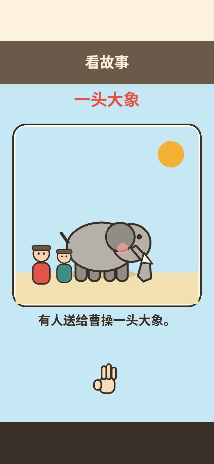 | 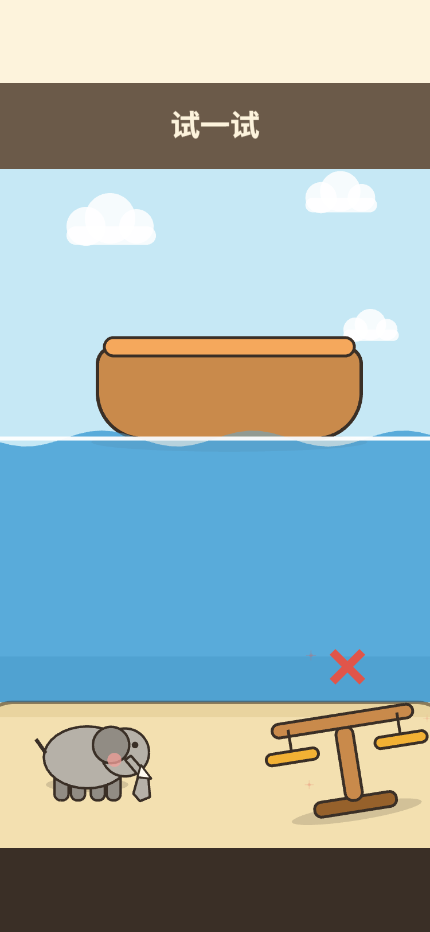 |  | 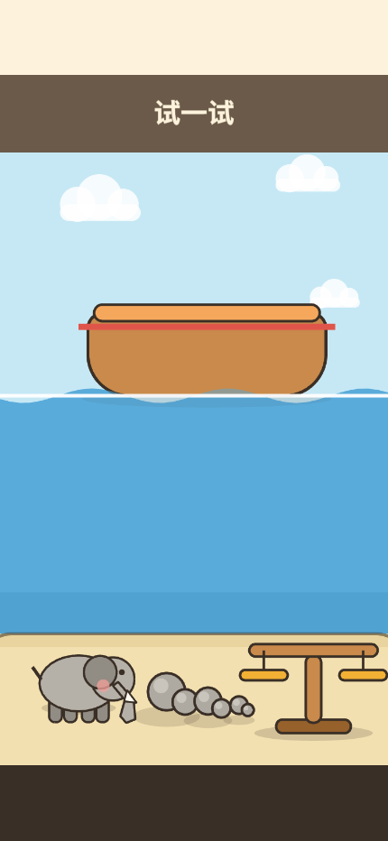 | 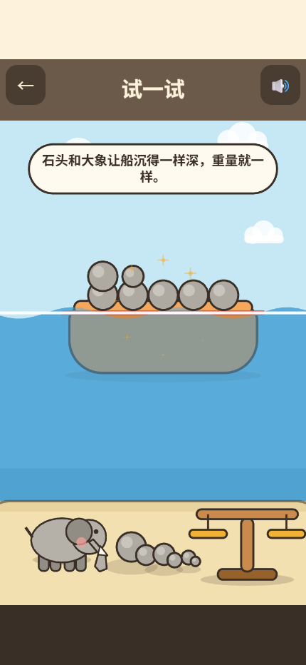 | 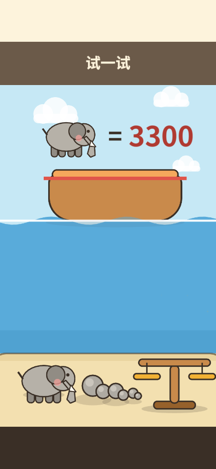 |

### 二、女娲补天（神话 · 修补）

天上破了五个洞，一个洞一种形状。把五色石拖进对应的洞里 —— **判定靠形状，不靠颜色**（色弱的孩子也能玩）。
补完一个，天就亮一分；五个都补好，五色霞光洒向大地。

| 天上五个洞 | 一块块补上 | 天补好了 |
|---|---|---|
|  |  |  |

### 三、后羿射日（神话 · 精准与分寸）

拖出去瞄准，松手射箭。十个太阳烤焦了大地，但**不能全射下来**。

射下九个之后，大地返绿、最后一个太阳变得温暖 —— 这时孩子如果把它也射了，**天会一下子黑下来**，
太阳自己回来，屏幕上一句「要留一个太阳」。零惩罚，自己撞一次就懂了。

| 十日并出 | 拉弓瞄准 | 射九留一 |
|---|---|---|
| 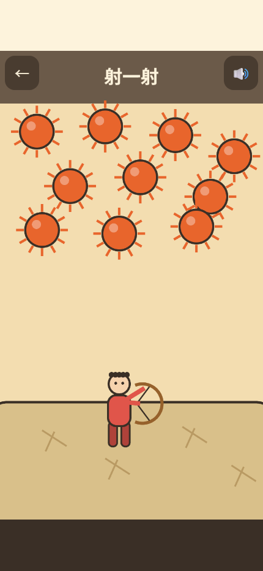 | 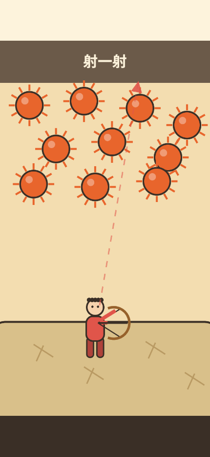 | 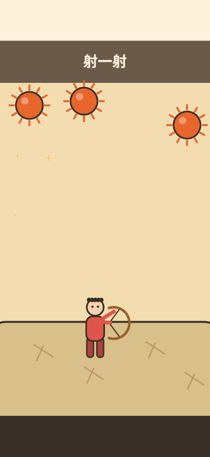 |

### 四、精卫填海（神话 · 微小的坚持）

点一下，精卫就衔一块石头飞过海面投下去。**它很小，海很大** —— 这种不成比例，正是这个典故的分量。
填到最后，海上浮起一小片陆地，它还在飞。

| 一只小鸟，一片大海 | 填到一半 | 海上多了块陆地 |
|---|---|---|
| 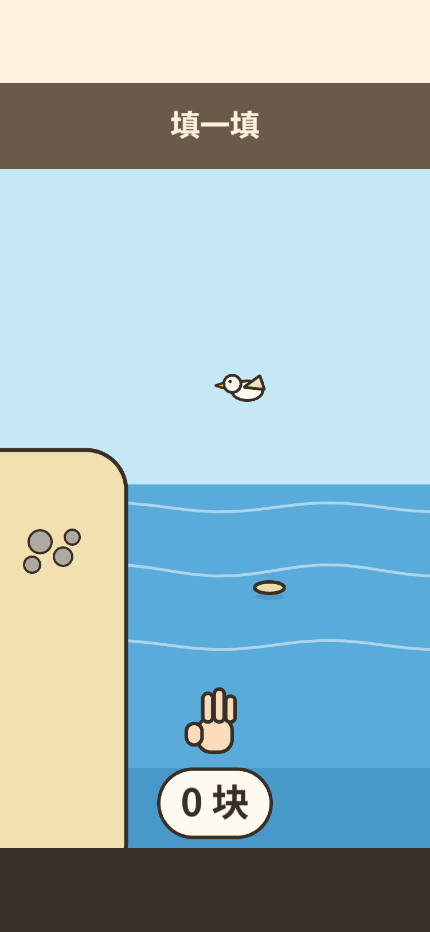 | 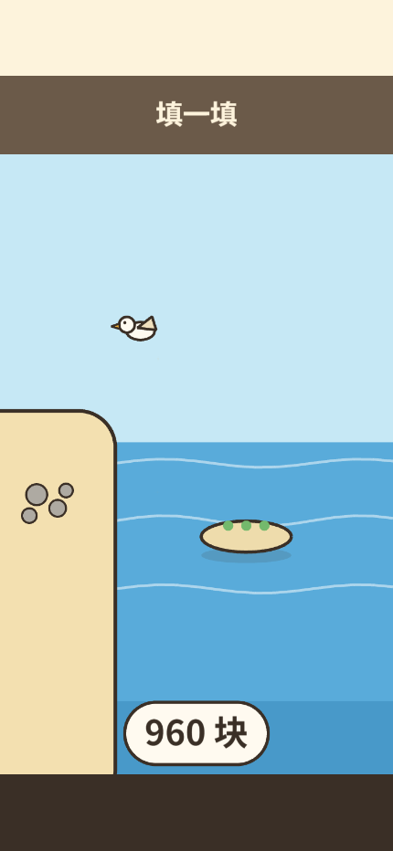 | 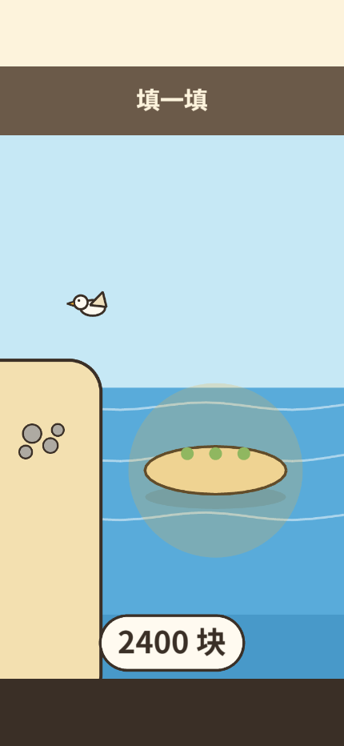 |

### 五、夸父追日（神话 · 奔跑）

**按住就跑**，松手就慢下来，太阳越跑越远。追到河渭时停下喝一口，再接着追。
他没能追上太阳 —— 但结局画面里没有他，只有一片开花的桃林。

| 一直追 | 河渭喝水 | 手杖化成的桃林 |
|---|---|---|
| 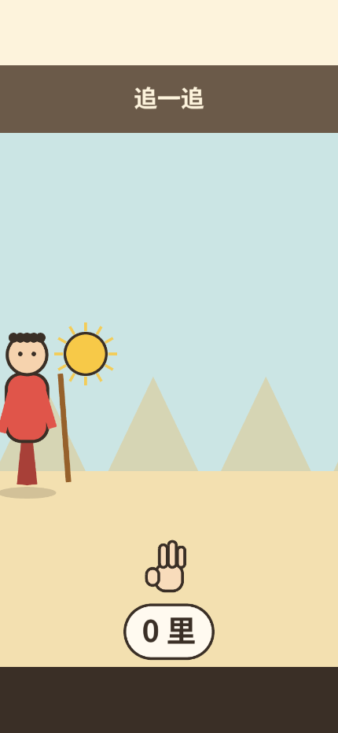 | 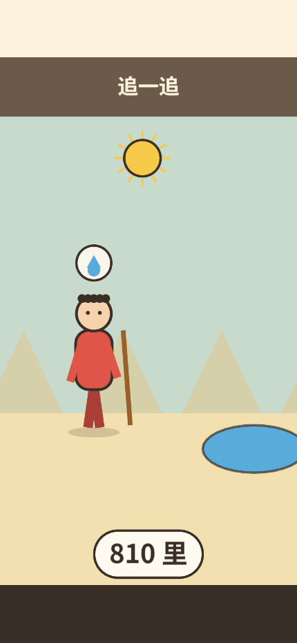 | 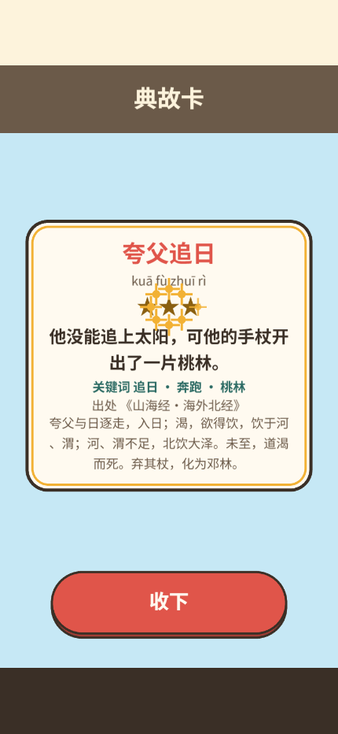 |

### 六、愚公移山（寓言 · 传承）

点一下挖一担。挖到三成，**河曲智叟出现**，抱着胳膊摇头嘲笑；
挖到六成，愚公老了，**把锄头交给下一代** —— 画面上的挖山人从一代变成两代、三代。

| 两座大山 | 智叟来了 | 子子孙孙 |
|---|---|---|
| 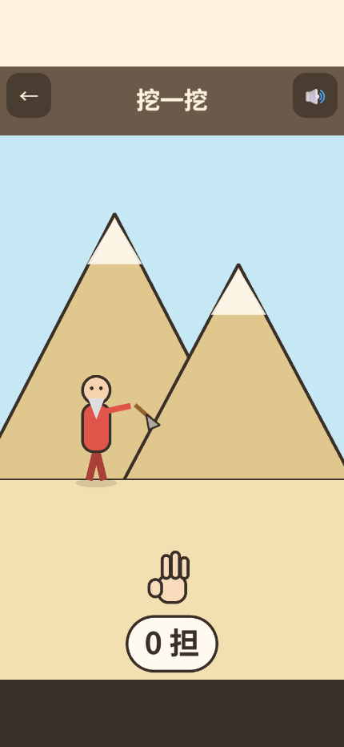 |  |  |

### 七、盘古开天辟地（神话 · 创造与化身）

五段式，由三个模板 + 一个专属场景拼成：

1. **开** — 连点蛋壳 4 次，混沌炸开，亮粒子上升、暗块下沉（专属场景）
2. **撑** — 连点 40 次，天升一丈、地降一丈、**盘古在画面里被真的拉长**，点满一万八千年
3. **化** — 拖 6 团光归位：左眼→太阳、右眼→月亮、头发→星辰、气息→风云、血液→江河、汗毛→草木

拿起一团光时，它该去的位置会自己发光——零失败、零文字；归位时用**语音**念出原文。
全程没有死亡表现：盘古是「躺下 → 化成光 → 光一件件回到世界」。

| 混沌之蛋 | 裂缝 | 撑天（一万四千年） | 拖光球归位 | 世界成形 |
|---|---|---|---|---|
|  |  |  |  |  |

### 八、神农尝百草（传说 · 先尝后分）

八株草摆在田垄上，每株草都顶着一个问号 —— **不尝一口，就不知道它是什么**。
把草拖到神农嘴边，他尝过之后，草上会多出一枚小牌子：能吃、能治病，还是不能吃；
牌子上的图案和木牍上的一模一样，不用认字。

没尝过就往木牍上放？草会被送回嘴边先尝一口 —— 不判错、不扣分。想分类，先自己试一口。

| 不知道是什么 | 先尝一口 | 分进木牍 |
|---|---|---|
| 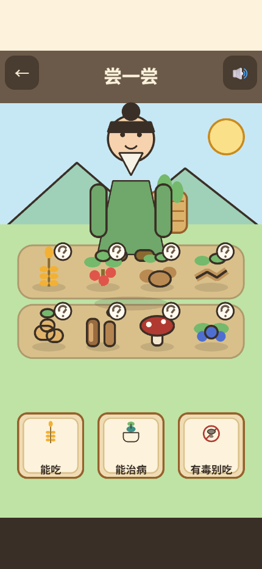 | 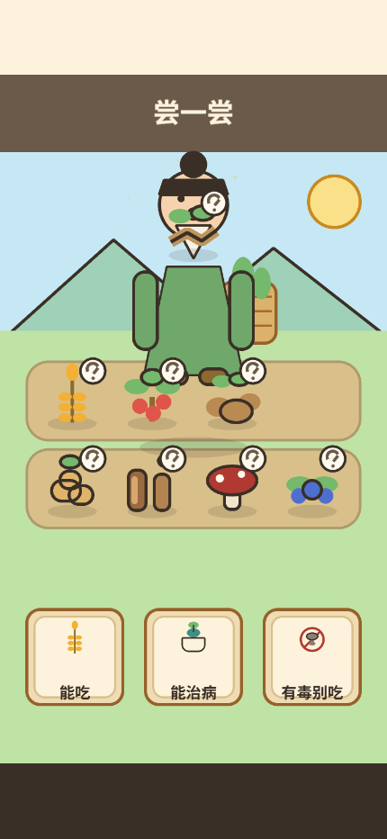 | 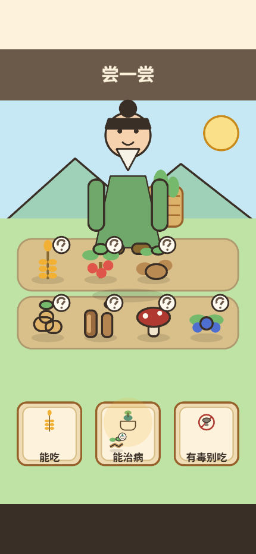 |

尝到毒草只是皱皱眉头、冒会儿金星，喝口水就过去了 —— **有毒的也要记下来**，别人就不用再尝。

### 九、大禹治水（传说 · 堵不如疏）

先让他亲手"堵"一次：点一下加一筐土，堤高一寸，水也涨一寸（涨得慢一点点，看起来真的有用）。
点到第十四下，水漫过堤顶 —— **堤垮了**。

然后才给他"疏"：手指在洪水上划出一条河道，水顺着走，水位一格格退下去，露出来的地上长出绿苗。
三段河道，每划完一段，他就路过一次家门口 —— 窗里亮着灯，他都没有进去。

| 一筐一筐筑堤 | 水漫过堤顶 | 划出一条河道 |
|---|---|---|
|  | 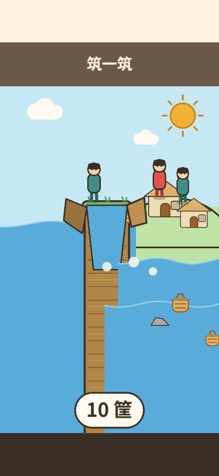 |  |

### 十、太公钓鱼（信史 · 等）

一屏渭水，主线只有一件事：**等**。
太阳在画面上方慢慢走，就是进度条；天边极远处的车马，一点一点近。

换弯钩、加鱼饵、换地方 —— 点了就得多等一会儿（最多三次，永远不会等不到头），而且**永远钓不到鱼**。
水下的鱼群游来游去，直钩悬在水面之上三尺。等文王到了跟前，要自己把直钩收起来 —— 不然这一场白等。

| 直钩悬在水上三尺 | 点他，听一句 | 点了诱惑 |
|---|---|---|
|  |  |  |

### 十一、烽火戏诸侯（信史 · 信用）

点一次火，火光一座座传向天边，诸侯的兵马赶来，**她笑了**。
信任有三格：点一次，少一格。第二次来的兵马少了一半，走的时候有人在摇头；第三次，**他们连城门都没到**。

第四次点火是真的 —— 天边真的起了烟。火光还是传了出去，**一个人也没有来**。
孩子是自己把信任点完的，全篇没有一句说教；出处注明"后世学者多存疑"，教训落在信用上，不落在褒姒身上。

| 夜里的烽火 | 火光传向天边 | 她笑了 | 一个人也没来 |
|---|---|---|---|
|  |  | 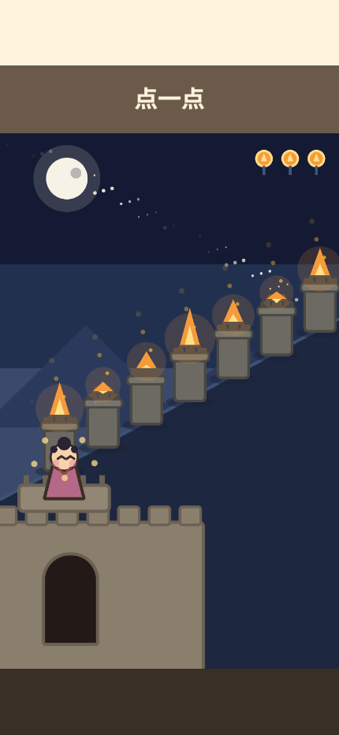 | 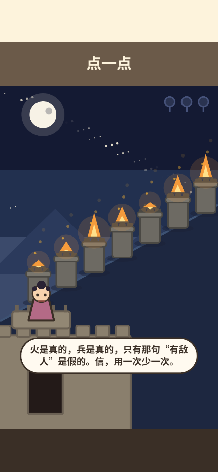 |

### 十二、杞人忧天（寓言 · 想明白）

他头顶飘着四个担忧泡泡：天会塌、地会陷、日月会掉、星星会坠。
托盘里是四个"想明白"：一团气、一块土、日月、一颗小石子。

拖过去，泡泡里演一小段"看一看"（气托着鸟和云、跺一跺脚土地稳稳的、太阳落下第二天又升起来、流星掉下来只是小石子），
泡泡「啵」地破掉，屋里亮一点。四个都破了，黑云散开，他在星光下睡着 —— **怕，是因为还没想明白**。

| 四个担忧 | 想通一个 | 睡着了 |
|---|---|---|
|  |  | 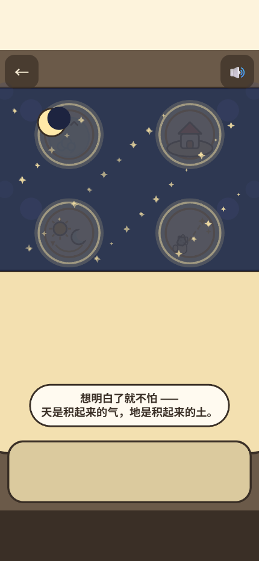 |

### 十三、刻舟求剑（寓言 · 参照系）

坐船过江，剑掉进水里。**剑一直在画面里，船一直在走** —— 全篇就靠这一个画面讲道理。
先照故事里的做法，在船帮上刻一道痕：船一漂，刻痕跟着船走，从记号处下水，只摸到水草。
船回到上游，这次可以刻在岸边的树上、或者在水面丢一个浮标 —— 不会动的地方，才找得到剑。

| 刻在船帮上 | 船漂走了，剑还在上游 | 改刻在树上，捞到了 |
|---|---|---|
|  | 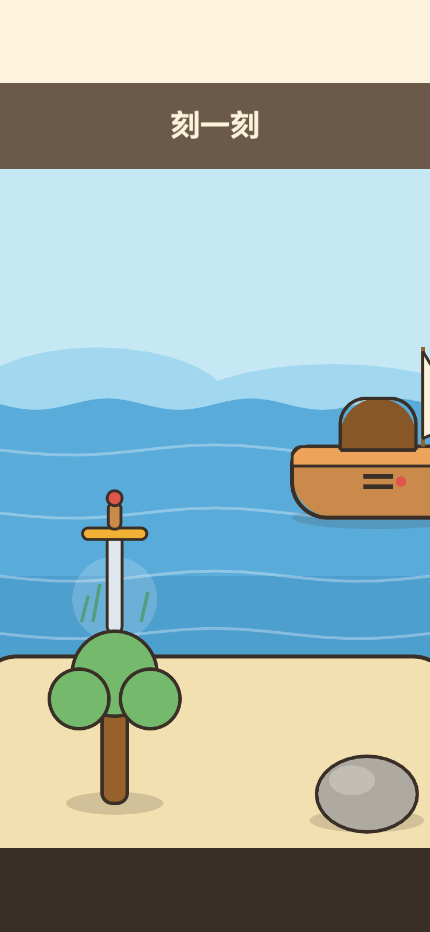 |  |

### 十四、朝三暮四（寓言 · 说法与实质）

七颗橡子串在一条绷直的草绳上，动的只有中间那块木牌。
"早上三颗、晚上四颗" —— 猴子炸毛；把木牌挪一格，"朝四暮三" —— 猴子立刻欢呼。
绳子上一直写着 **3 + 4 = 7**，怎么挪都是七颗：换的是说法，不是橡子。

| 朝三暮四，猴子在闹 | 挪一格，猴子就笑了 |
|---|---|
| 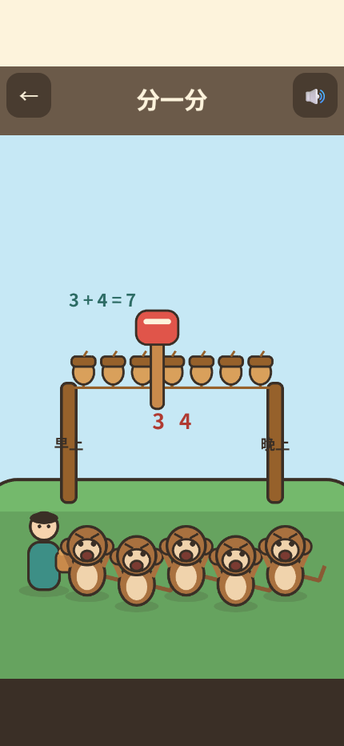 | 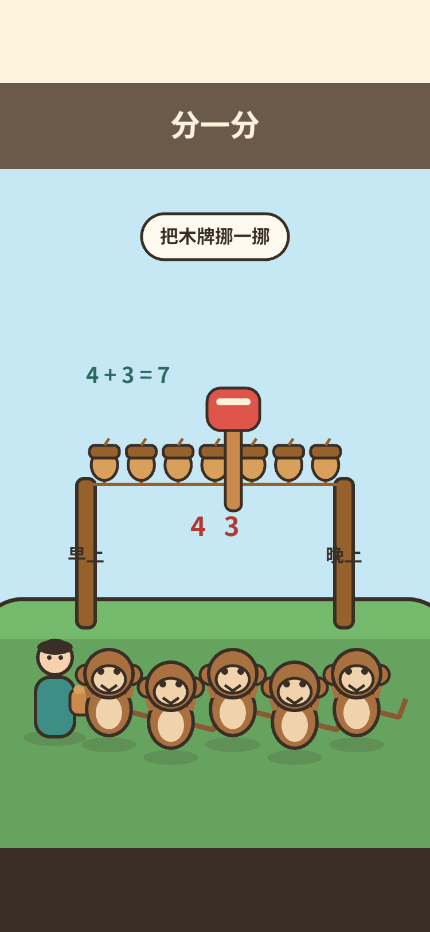 |

### 十五、狡兔三窟（信史 · 留后路）

草地上三个土坡，点一下就挖一铲。挖通一个洞，狐狸就来了 —— 一个洞口被守住，兔子就出不去。
再挖一个，躲得过狐狸；可猎人和老鹰一起来，守住两个洞口，还是不够。
**"三窟"不是文案说的，是被危险的数目逼出来的**（关卡数据里最凶的那一次守两个洞口）。

| 一个洞，被狐狸守住 | 三窟已就 |
|---|---|
| 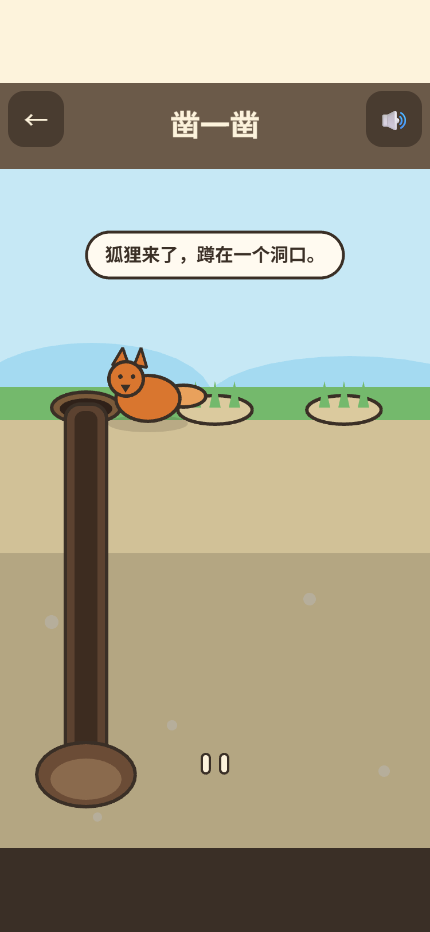 |  |

### 十六、百步穿杨（信史 · 练）

柳树上挂着五片柳叶，**自己一步一步往后退**：十步、三十步、五十步、八十步、百步。
越远叶子越小，判定也跟着变小；射中的叶子上留一个洞，再退十步。
（与后羿共用同一套拉弓手势，但一个在夜空射太阳、一个在白天柳林练柳叶 —— 这一部的主题是"练"）

| 十步 | 百步穿杨 |
|---|---|
| 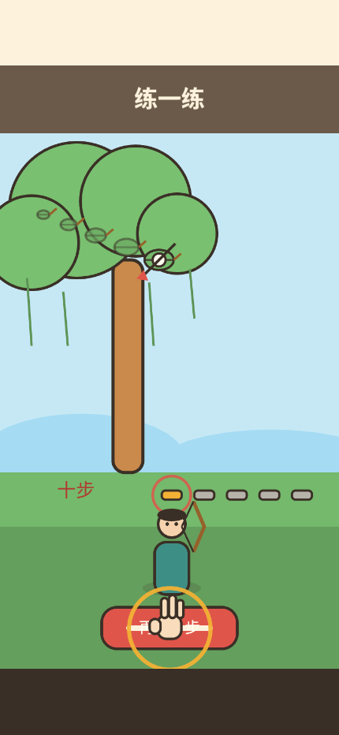 | 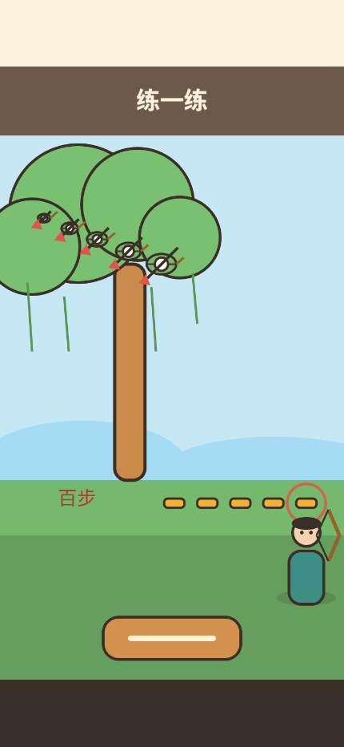 |

### 十七、庖丁解牛（寓言 · 顺着缝）

第一刀砍在骨头上，"当"一声，刀口多一个缺口 —— 先自己撞一次。
缝亮起来了：抓住一块，**顺着缝的方向推出去**，"咔"地滑开；最后三块不给提示，凭记住的结构自己推。
结局是一张完整的骨架，和一把十九年如新的刀。

| 第一刀，缺口 | 顺着缝解开 |
|---|---|
|  | 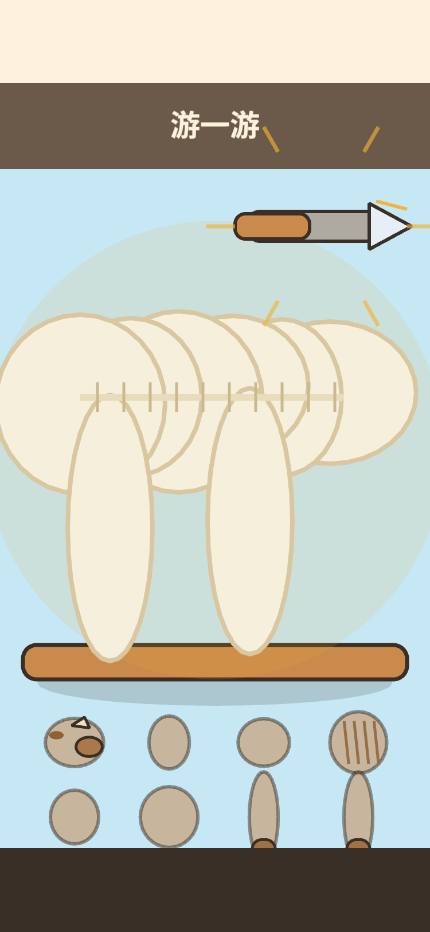 |

## 三十六计 · 第一辑：胜战计（第 1–6 计）

三十六计的第一辑上线了：**一计一个游戏，每计一个专属动词**。
它们不是"典故"而是"兵法"（`kind: strategy`），在大厅里单独一组、按计策序号排；

| # | 计 | 这一关在做什么 | 玩法模板 |
|---|---|---|---|
| 1 | 瞒天过海 | 给显眼的东西挑"最平常的外壳"，一盏巡回的灯扫过来时混过检查口 | `ruse` |
| 2 | 围魏救赵 | 正面推不动，去点他非救不可的两处要害；守备一撤，正面才推得动 | `siege` |
| 3 | 借刀杀人 | 工地上的大石搬不动：垫上支点、接上木棍与水车，借别人的力气 | `borrow` |
| 4 | 以逸待劳 | 三通鼓：前两通忍住不出手，第三通之后的窗口里一击定局 | `stillness` |
| 5 | 趁火打劫 | 营地在"稳"与"乱"之间摆：只有乱起来的那一小段窗口里，活才干得完 | `window` |
| 6 | 声东击西 | 敲锣把灯留在左边，人从右边走过去；被照到只是退回，不惩罚 | `ruse`（divert） |

| 混过检查 | 打要害 | 借力 |
|---|---|---|
|  | 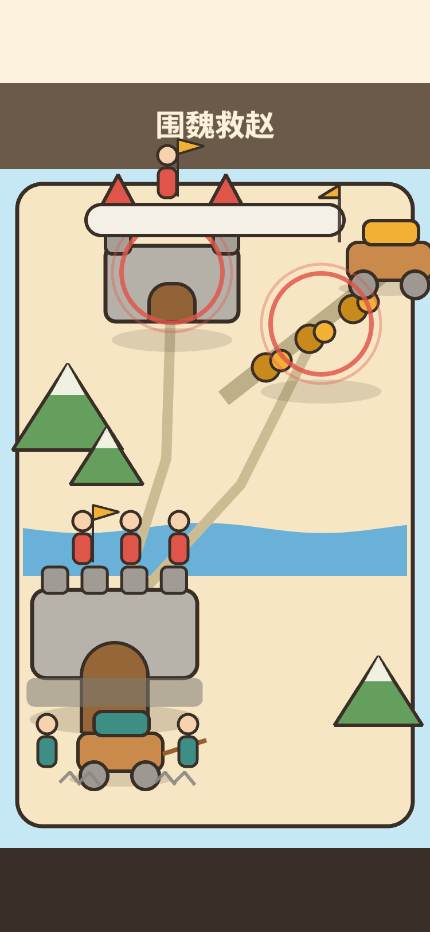 | 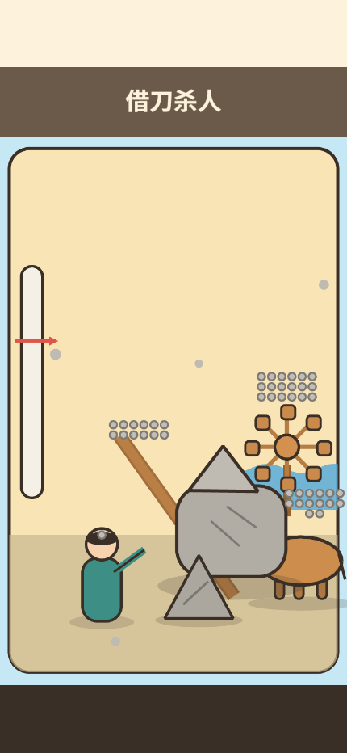 |

| 等第三通鼓 | 抓窗口 | 声东击西 |
|---|---|---|
| 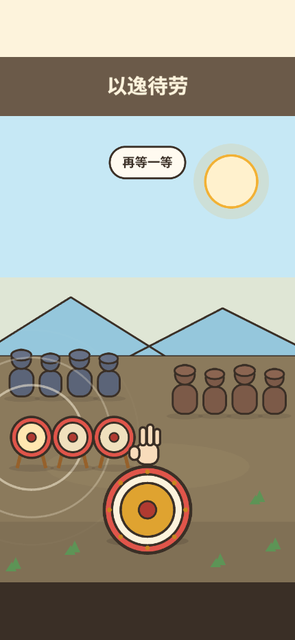 |  |  |

**儿童化口径**（六条硬规矩写在 [三十六计方案.md](docs/三十六计方案.md) 第三节）：
计名与原文保留，冲突抽象成难题 / 赛场 / 工地，不出现流血与死亡；
防御性的几计（笑里藏刀 / 反间计 / 美人计 / 苦肉计）**只教"识别"**，不教怎么使；
每一计都写了史源战例与《三十六计》本计按语 —— 逐字确证不了的战例原文宁可用按语，也不编。

这一辑为"每一计一个专属动词"新写了 **5 个玩法模板**（`ruse` / `siege` / `borrow` /
`stillness` / `window`），加上已确认的路线：其余 30 计按六套逐辑加，
`wait` / `split` / `trace` 三个已有模板会被复用。每辑开工前先出
`docs/三十六计-第N辑方案.md`（第一辑：[三十六计-第一辑方案.md](docs/三十六计-第一辑方案.md)）。

## 三十六计 · 第二辑：敌战计（第 7–12 计）

| # | 计 | 这一关在做什么 | 玩法模板 |
|---|---|---|---|
| 7 | 无中生有 | 雾里在船帮的空位上一笔笔画草人：影子会淡，得不停补笔，把"疑心"撑到满 | `show` |
| 8 | 暗度陈仓 | 明面修栈道会回落、暗线走小路要点到底 —— 两条线抢同一根手指 | `twoline` |
| 9 | 隔岸观火 | 只要出手调解，两边立刻和好一致对外 —— 这一关的玩法是"忍住不动" | `wait`（复用） |
| 10 | 笑里藏刀 | 满口好话，但眼神、袖口、手指会露破绽：**这一计教的是识破，不教怎么使** | `read` |
| 11 | 李代桃僵 | 田忌赛马：用下驷对上驷，三局两胜的配对编排 | `matchup` |
| 12 | 顺手牵羊 | 队伍沿路走，机会每隔一轮路过一次，只在那一小段窗口里抓得住 | `window`（glimpse） |

| 无中生有 | 暗度陈仓 | 隔岸观火 |
|---|---|---|
|  | 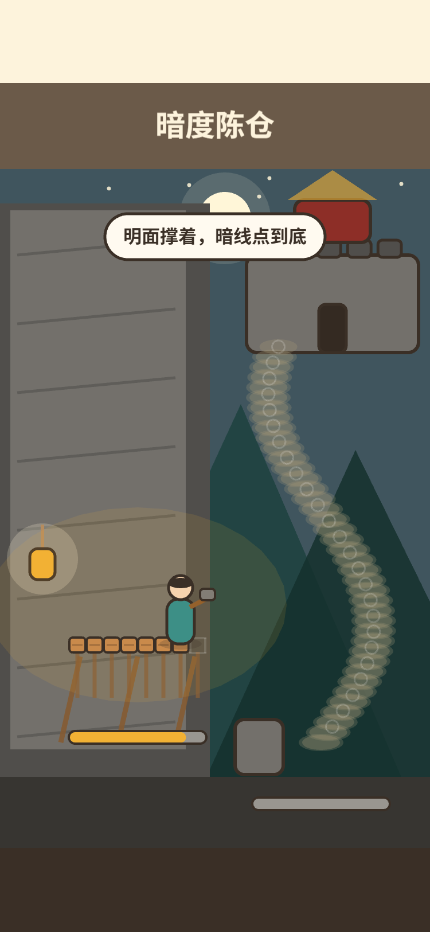 | 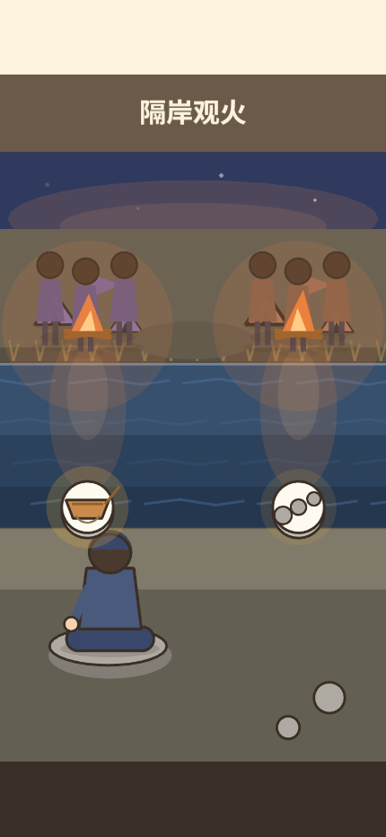 |

| 笑里藏刀 | 李代桃僵 | 顺手牵羊 |
|---|---|---|
|  | 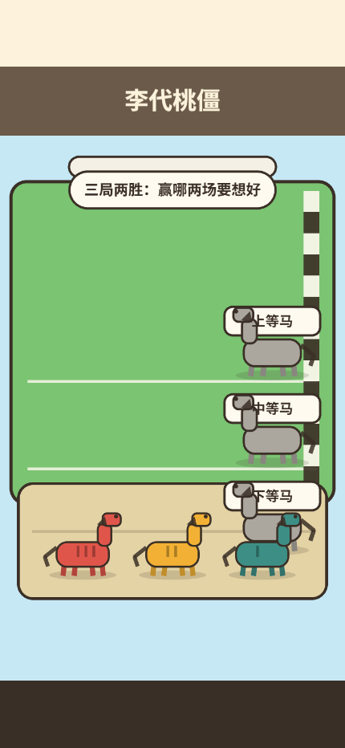 | 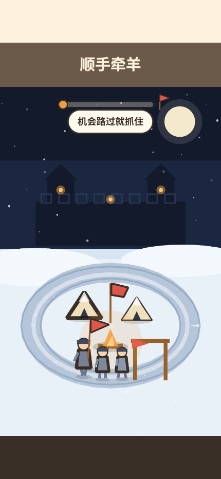 |

第二辑新增 **4 个模板**（`show` / `twoline` / `read` / `matchup`）+ 扩展 `window` 的
`glimpse` 模式，规格书见 [三十六计-第二辑方案.md](docs/三十六计-第二辑方案.md)。

## 三十六计 · 第三辑：攻战计（第 13–18 计）

| # | 计 | 这一关在做什么 | 玩法模板 |
|---|---|---|---|
| 13 | 打草惊蛇 | 一丛一丛敲过去 —— 敲到蛇，附近的草丛会一起被搅乱（"试"本身有代价） | `probe` |
| 14 | 借尸还魂 | 把旧旗竖起来，散掉的人自己归队：旗号就是名号 | `borrow`（banner） |
| 15 | 调虎离山 | 把看守引开，趁空档把东西拿走 —— 要挑能空够久的那个诱饵点 | `lure` |
| 16 | 欲擒故纵 | 按住追、松手放：距离要待在区间里，逼急了会反抗、离远了会跟丢 | `chase` |
| 17 | 抛砖引玉 | 先给出一块"砖"，对方拿出更好的来换 —— 最不起眼的那块换回最多 | `lure`（trade） |
| 18 | 擒贼擒王 | 一排一模一样的身影里，用没有杀伤的蒿箭一个个试出"王" | `probe`（spot） |

| 打草惊蛇 | 借尸还魂 | 调虎离山 |
|---|---|---|
| 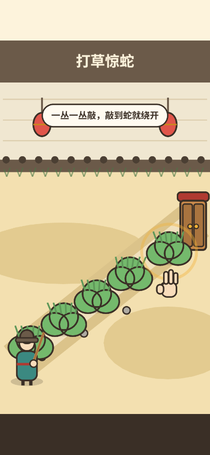 | 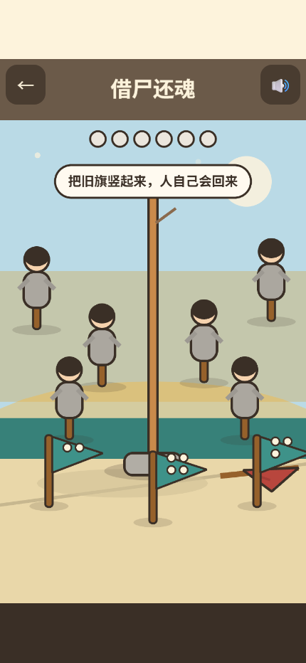 |  |

| 欲擒故纵 | 抛砖引玉 | 擒贼擒王 |
|---|---|---|
|  |  | 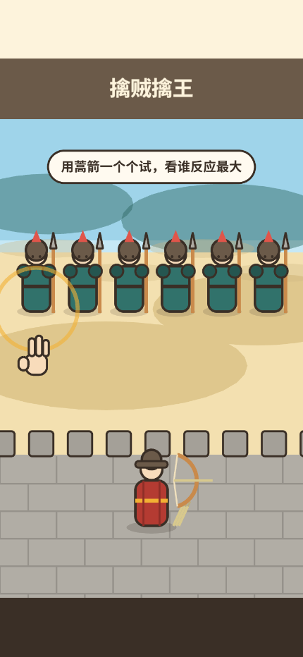 |

第三辑新增 **3 个模板**（`probe` / `lure` / `chase`）+ 扩展 `borrow` 的 `banner` 模式
（`force` 分支一行未动），规格书见 [三十六计-第三辑方案.md](docs/三十六计-第三辑方案.md)。

## 三十六计 · 第四辑：混战计（第 19–24 计）

| # | 计 | 这一关在做什么 | 玩法模板 |
|---|---|---|---|
| 19 | 釜底抽薪 | 不跟火硬碰：从底下把柴一根根抽走，抽到"根上的那根"火势骤降 | `siege`（support） |
| 20 | 混水摸鱼 | 窗口是**自己搅出来的**：点水面搅浑，浑水期鱼才慢下来，清了就抓不动 | `window`（stir） |
| 21 | 金蝉脱壳 | 把人一个个换成"样子一样"的替身；检查者每隔一会儿抬头看一次 | `swap` |
| 22 | 关门捉贼 | 抢在贼跑掉之前把出口一扇扇关上；没关完他就从最近的门跑了（可以重来） | `siege`（close） |
| 23 | 远交近攻 | 一圈势力：近的先解决、远的先结好 —— 顺序点错只是重排 | `matchup`（order） |
| 24 | 假道伐虢 | 先谈成借路，再按顺序取下沿途关口，最后回师（虞国的教训：唇亡齿寒） | `chain` |

| 釜底抽薪 | 混水摸鱼 | 金蝉脱壳 |
|---|---|---|
|  | 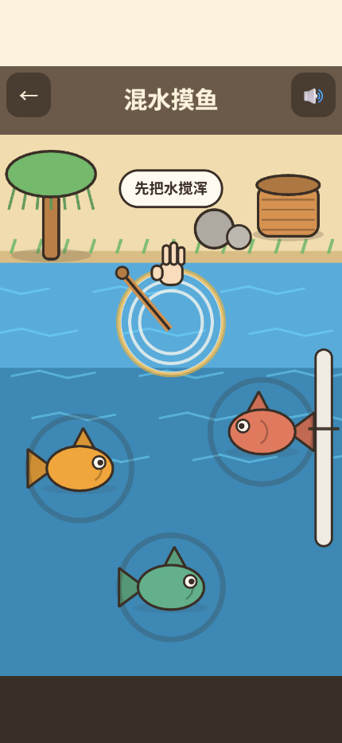 |  |

| 关门捉贼 | 远交近攻 | 假道伐虢 |
|---|---|---|
| 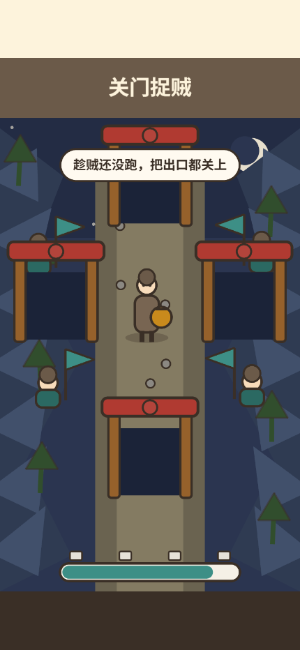 | 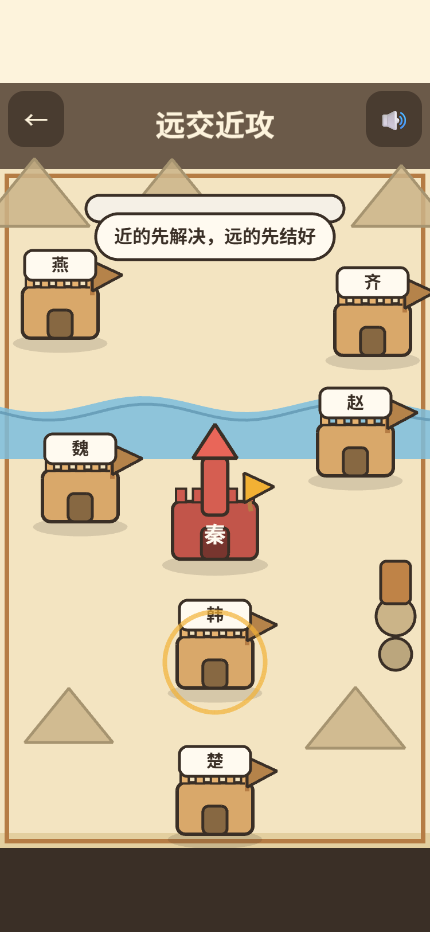 | 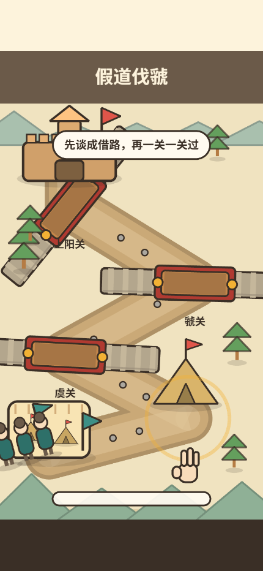 |

第四辑新增 **2 个模板**（`swap` / `chain`）+ **三处扩展**（`siege` 加 support / close、
`window` 加 stir、`matchup` 加 order）—— 扩展时老模式（`vital` / `fire` / `glimpse` / `pair`）
的判定与既有单测一行未动，规格书见 [三十六计-第四辑方案.md](docs/三十六计-第四辑方案.md)。

## 三十六计 · 第五辑：并战计（第 25–30 计）

| # | 计 | 这一关在做什么 | 玩法模板 |
|---|---|---|---|
| 25 | 偷梁换柱 | 一排承重柱要换成**外形一模一样**的新柱；换一根得按住干一会儿，而检查者每隔几秒**清点**一次 | `swap`（beam） |
| 26 | 指桑骂槐 | 不能点名：场上桑、槐、钟、鼓，敲**他听得懂的那样**，该听懂的人自己往前迈一步 | `probe`（hint） |
| 27 | 假痴不癫 | 对手一次次试探，**试探期任何点击都算露馅**；只有试探之间的空档能推进一步 | `stillness`（feign） |
| 28 | 上屋抽梯 | 先给方便：一级级把梯子搭好，看他顺着走到位，再把梯子抽掉（抽早了只是他掉回来） | `siege`（ladder） |
| 29 | 树上开花 | 借现成的树与城墙挂旗：支点能挂几面、每面顶多少"规模"各不相同，凑够规模就成 | `show`（borrow） |
| 30 | 反客为主 | 每一步都要**先被允许**：允许只持续一会儿，过期作废，得重新求（急不得） | `chain`（step） |

| 偷梁换柱 | 指桑骂槐 | 假痴不癫 |
|---|---|---|
| 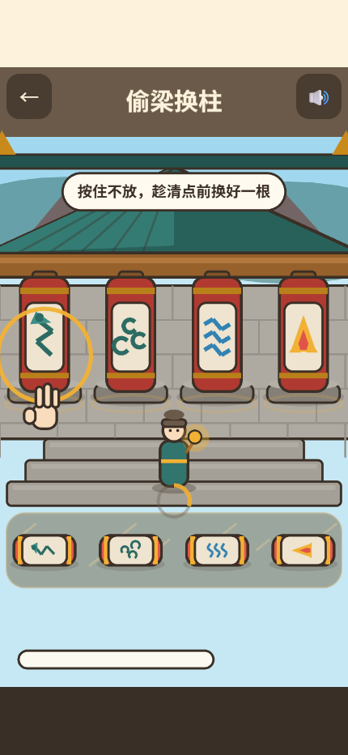 | 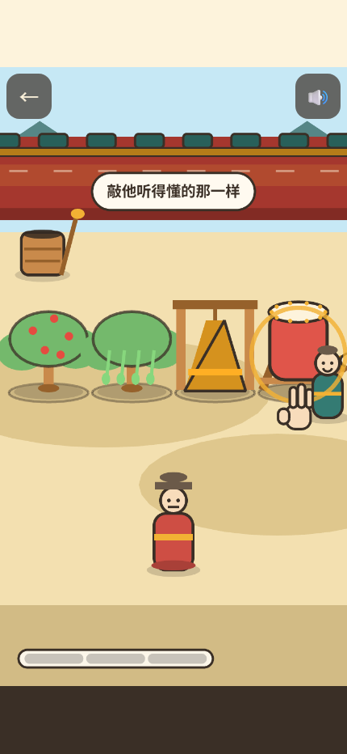 | 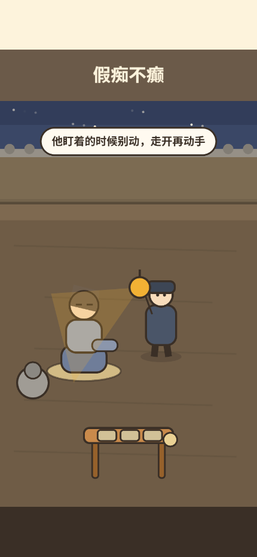 |

| 上屋抽梯 | 树上开花 | 反客为主 |
|---|---|---|
| 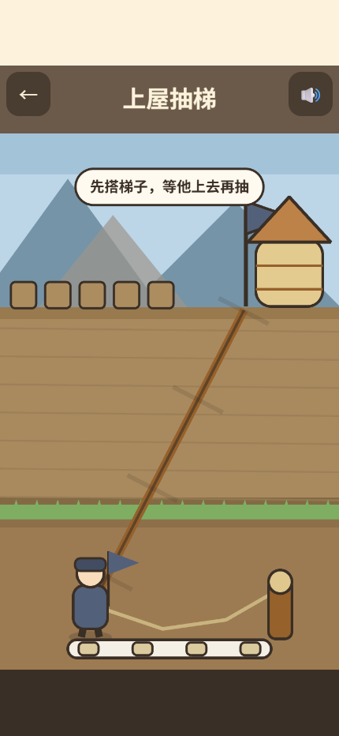 | 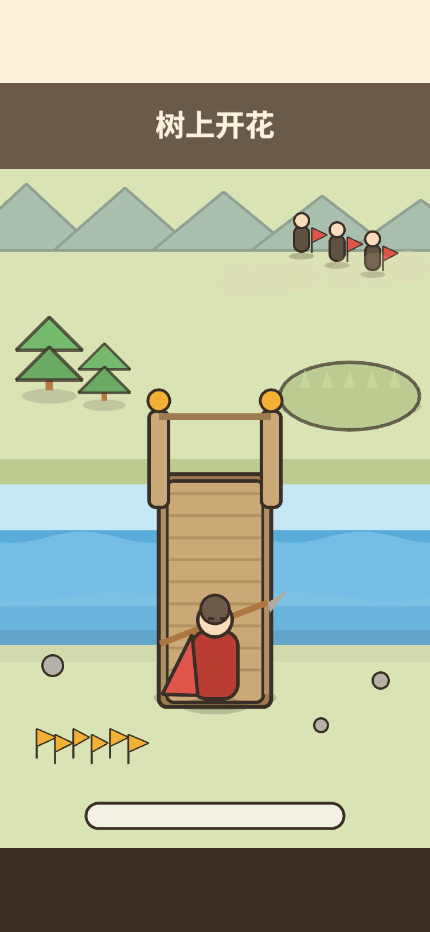 | 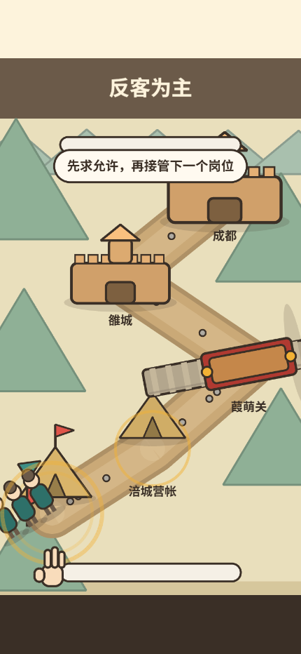 |

第五辑**不新增模板**：六计是给六个已有模板各加一个新模式（`swap.beam` / `probe.hint` /
`stillness.feign` / `siege.ladder` / `show.borrow` / `chain.step`）—— 老模式（`swap.shell` /
`probe.knock`·`spot` / `stillness.bide` / `siege.vital`·`support`·`close` / `show.draw` /
`chain.pass`）的判定与既有单测一行未动，规格书见
[三十六计-第五辑方案.md](docs/三十六计-第五辑方案.md)。

## 设计原则：少写字，多动手

四十七部游戏加起来，屏幕上几乎没有教学文字：开场的两句话，加上刚进玩法（或卡住时）出现的一句短提示
（故事页点早了，也只会回一句"先听完这个故事"）。
其余全靠图形、动画、音效与语音。孩子是「做」出这个办法，而不是被告知。

## 两条硬规矩

### 一、故事必须听完，才轮到动手

每一幕的旁白没有念完之前，屏幕上不会出现那只"点一下继续"的小手 —— 点哪都不翻页。
有语音时等它真的念完；**没有语音的设备（静音、没装语音包、无头浏览器）按"读一遍"的时间兜底**，
否则"听完才能继续"在那些设备上等于没有。念完会发一个 `story:ready` 事件，
无头验证与端到端测试靠它确定性地翻页；只有 `?autoplay=1`（自动通关）与
`?story=instant`（截图巡检）这两个调试开关能跳过等待。

还在念的时候，屏幕下方是一个小喇叭 + 一条进度条；点早了只回一句"先听完这个故事"，不翻页。

| 正在念：小喇叭 + 进度条 | 点早了：只回一句"先听完" |
|---|---|
| 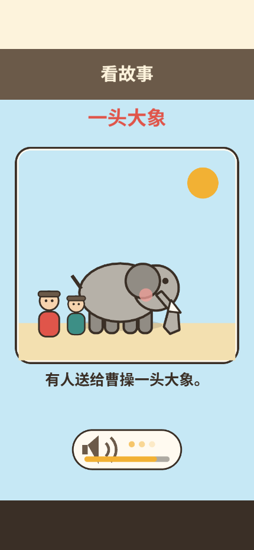 |  |

理由很直接：故事是这个产品的正片。跳过它，后面的动手环节就成了没有来由的小游戏 ——
孩子记住了操作，却没记住典故。难度的上调也是同一个目的：让"听过的故事"必须被真的用上。

### 二、难度整体上调一档，但失败惩罚依然是零

| 典故 | 调了什么 |
|---|---|
| 曹冲称象 | 大象 3000 → 3300，容差 100 → 80：光搬大石头凑不出来，得大小搭配 |
| 盘古开天地 | 撑天 30 下 → 40 下；"归位"的判定宽容度 70 → 52 |
| 女娲补天 | 五个洞的判定半径 74 → 62 |
| 后羿射日 | 命中半径 64 → 56（射在太阳本体上依然稳中） |
| 精卫填海 | 30 下 → 40 下 |
| 夸父追日 | 一次跑完 6 秒 → 7.2 秒：河渭那一口要自己找时机 |
| 愚公移山 | 30 担 → 40 担，三个里程碑照旧 |
| 神农尝百草 | 六株草 → 八株（多了野薯与桂皮），嘴边与木牍的判定同时收紧 |
| 杞人忧天 | 四个泡泡的判定半径 82 → 70 |
| 烽火戏诸侯 | 五座烽火台 → 七座：火光要传得更远才到天边 |
| 太公钓鱼 | 等 45 秒 → 58 秒；动心一次的代价 5 秒 → 7 秒 |
| 大禹治水 | 筑堤 10 筐 → 14 筐；三段河道每段 3 个锚点 → 4 个 |
| 刻舟求剑 | 捞剑容差 90 → 70；船漂得更远（400 → 460） |
| 朝三暮四 | 木牌判定半径 86 → 58；一侧少于两颗就算贪心 |
| 狡兔三窟 | 每个洞 3 铲 → 4 铲；土坡判定半径 120 → 100 |
| 百步穿杨 | 五片柳叶 44/36/30/24/19 → 36/30/25/20/15（**画的和判的一起改**） |
| 庖丁解牛 | 最后三块不给提示（原为两块）；抓取半径与"顺缝"的角度公差一起收紧 |

各场景"卡住才出现的提示"统一推后了 1.5~3 秒，扣分与失败依然不存在：
点错了只是"再试试"，没有一个操作会让这一局玩不下去。

## 目录结构

```
apps/site                  Vue 3.5 外壳：游戏馆（按分组分区）/ 游戏宿主 / 图鉴
packages/game-kit          契约层（GameModule / GameContext / 事件），不含 Phaser
packages/content           典故数据 + zod schema
packages/templates         玩法模板：story / substitution / tap / place / aim / sort / trace / wait / mark / split / burrow / butcher / quiz / reward
packages/phaser-kit        Phaser 启动器、主题、基础场景
packages/platform          Web 实现：IndexedDB / WebAudio / TTS / 生命周期
packages/progress          存档、复习调度（纯函数，可单测）
games/caochong-elephant    曹冲称象（等量代换：substitution 模板）
games/pangu                盘古开天辟地（撑天 tap + 化身 place + 专属开蛋场景）
games/houyi / nuwa / jingwei / kuafu / yugong   后羿射日 / 女娲补天 / 精卫填海 / 夸父追日 / 愚公移山
games/shennong / dayu / taigong / fenghuo / qiren  神农尝百草 / 大禹治水 / 太公钓鱼 / 烽火戏诸侯 / 杞人忧天
games/kezhou / zhaosanmusi / jiaotu / yangyouji / paoding  刻舟求剑 / 朝三暮四 / 狡兔三窟 / 百步穿杨 / 庖丁解牛
e2e                        Playwright 冒烟 + 真实操作 + 截图
```

## 三条架构铁律

1. **逻辑与渲染分离**：规则写在纯 TS 里，不 import Phaser，可脱离浏览器单测。
2. **游戏不碰环境**：存档 / 音频 / 生命周期一律走 `GameContext.services`，禁止直接 `localStorage` / `fetch`。
3. **每个游戏可无头直达**：支持 `?seed=&autoplay=1`，否则无法自动化验证。

详见 [docs/技术方案.md](docs/技术方案.md)。
