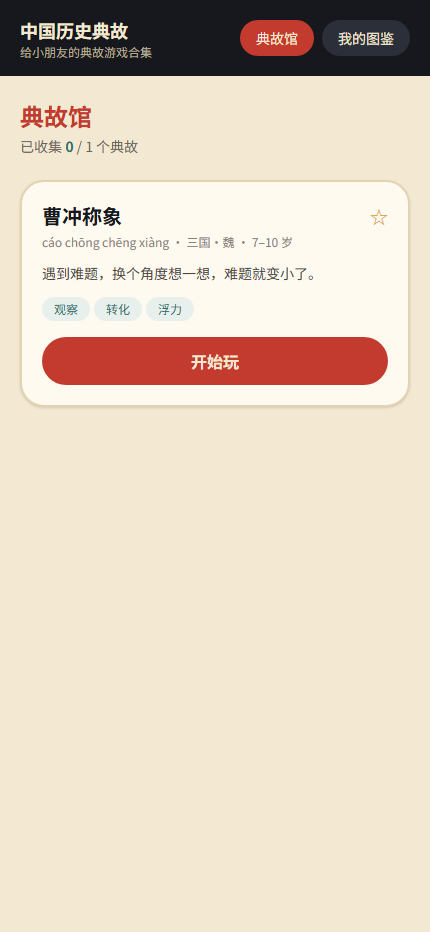
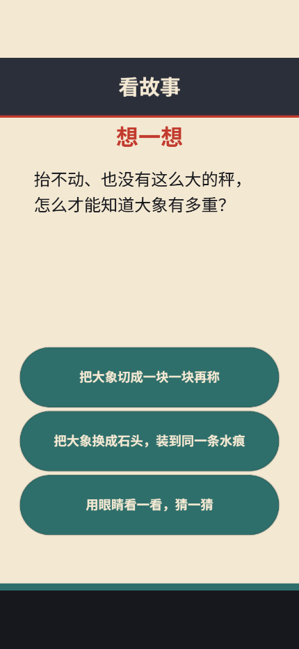
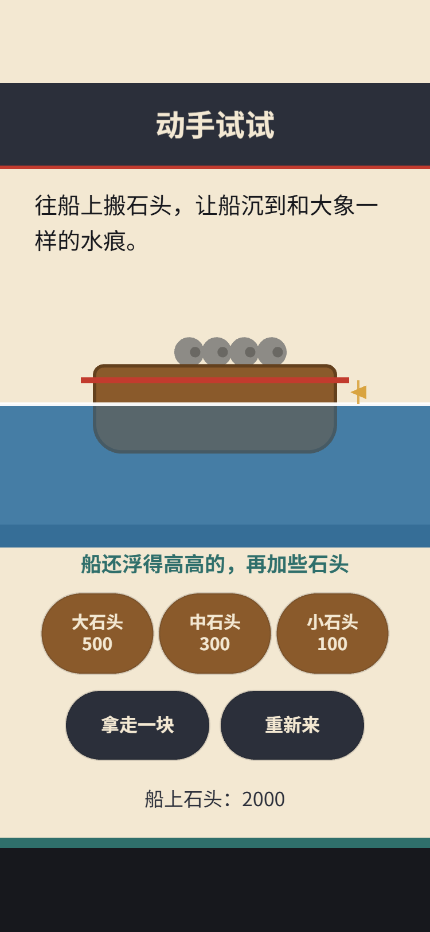
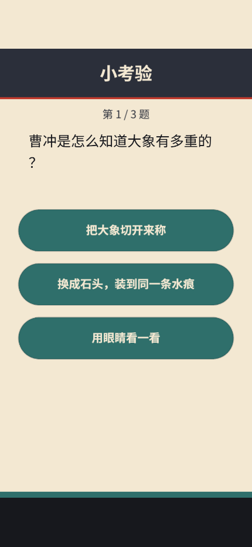
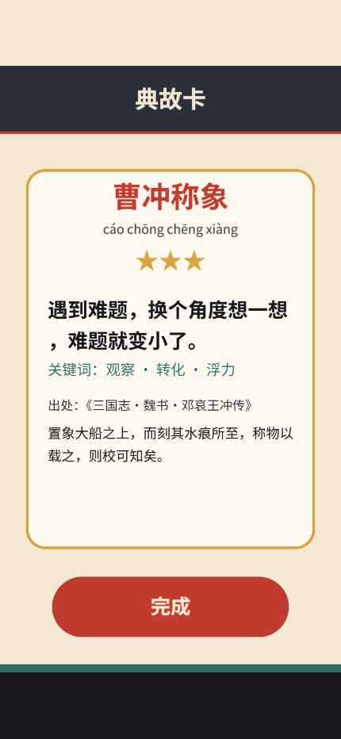

# CHAGS · 中国历史典故儿童游戏合集

Chinese Historical Anecdotes Game Series —— 一个典故一个小游戏，让小朋友在"做"故事的过程中记住典故。

## 技术栈

Phaser 4.2（游戏）· Vue 3.5 + Pinia（外壳）· Vite 8 · TypeScript 5.9.3 · pnpm workspace · Vitest · Playwright

> ⚠️ TypeScript 刻意锁在 **5.9.3**：最新的 7.x 移除了 `./lib/tsc` 子路径导出，
> `vue-tsc@3.3.13` 会直接报 `ERR_PACKAGE_PATH_NOT_EXPORTED`（已实测）。等 vue-tsc 跟进后再升级。

## 快速开始

```bash
pnpm install
pnpm dev            # 开发服务器 http://127.0.0.1:5183
pnpm verify         # typecheck + lint + test + content:check + build（提交前必须全绿）
pnpm e2e            # Playwright 端到端（需先 npx playwright install chromium）
pnpm e2e:dist       # 针对生产构建产物再跑一遍（验证 chunk 懒加载）
```

调试直达链接：`/?autoplay=1#/play/caochong-elephant`（自动通关，用于无头验证）

## 当前进度（阶段 0 已通过）

`pnpm verify` 全绿；真实浏览器端到端 3 项通过；首屏 shell **59.5 KB gzip**（不含 Phaser），游戏 chunk 仅在进入游戏时加载。

| 典故馆 | 分幕绘本 | 关键抉择 |
|---|---|---|
|  |  |  |

| 亲手称象 | 小考验 | 典故卡 |
|---|---|---|
|  |  |  |

> 阶段 0 刻意零美术资源、零音频文件：几何图形 + WebAudio 合成音效 + 浏览器 TTS 旁白，
> 先把“看 → 做 → 记”的闭环跑通。换真资源时不改游戏代码。

## 目录结构

```
apps/site                  Vue 3.5 外壳：典故馆 / 游戏宿主 / 图鉴
packages/game-kit          契约层（GameModule / GameContext / 事件），不含 Phaser
packages/content           典故数据 + zod schema
packages/templates         玩法模板：story / balance / quiz / reward
packages/phaser-kit        Phaser 启动器、主题、基础场景
packages/platform          Web 实现：IndexedDB / WebAudio / TTS / 生命周期
packages/progress          存档、复习调度（纯函数，可单测）
games/caochong-elephant    曹冲称象（阶段 0 样板）
e2e                        Playwright 冒烟
```

## 三条架构铁律

1. **逻辑与渲染分离**：规则写在纯 TS 里，不 import Phaser，可脱离浏览器单测。
2. **游戏不碰环境**：存档 / 音频 / 生命周期一律走 `GameContext.services`，禁止直接 `localStorage` / `fetch`。
3. **每个游戏可无头直达**：支持 `?seed=&autoplay=1`，否则无法自动化验证。

详见 [docs/技术方案.md](docs/技术方案.md)。
